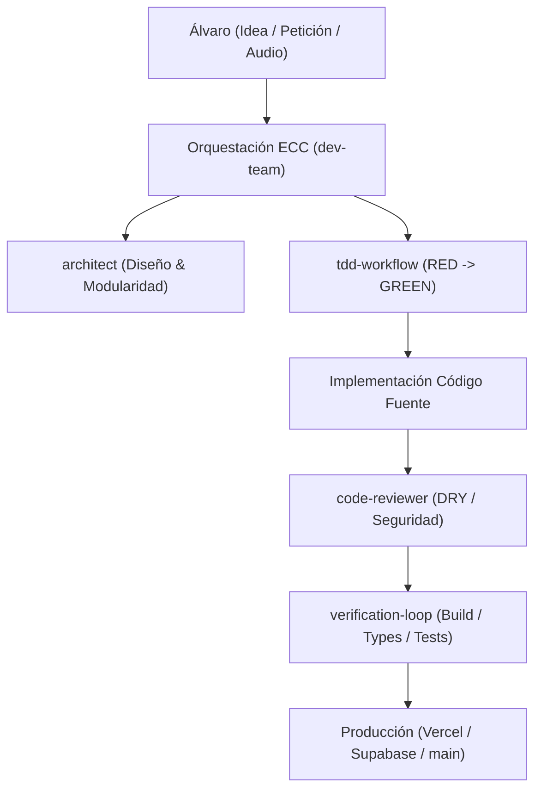

# Guía de Uso de Everything Claude Code (ECC) en IronManApp

Esta guía explica cómo exprimir al máximo el ecosistema de **Everything Claude Code (ECC)** instalado en `.agents/` para acelerar el desarrollo, blindar la aplicación contra errores y llevar a cabo la reestructuración hacia la interfaz centralizada minimalista.

---

## 1. ¿Qué aporta ECC a IronManApp?

**ECC no es una librería de código que se ejecute en el navegador del usuario**, sino un **marco de trabajo de ingeniería agentica de élite** para pair-programming con la IA. Transforma al asistente de un simple autocompletador de código en un equipo de ingeniería completo con roles definidos, puertas de calidad estrictas y bucles de verificación automatizados.

---

## 2. Los 6 Agentes Clave para IronManApp

En la carpeta `.agents/agents/` dispones de agentes especializados que puedes invocar o pedirle al asistente que utilice según la tarea:

| Agente | Cuándo usarlo en IronManApp | Prompt de ejemplo |
| :--- | :--- | :--- |
| **`code-reviewer`** | Tras escribir o editar código nuevo para detectar duplicidades (DRY), vulnerabilidades o mutaciones indebidas de estado. | *"Revisa este cambio con el agente code-reviewer de ECC antes de subirlo."* |
| **`architect`** | Al diseñar nuevas funcionalidades complejas (la pantalla principal centralizada con chat por voz, rediseño estilo Apple). | *"Actúa como architect de ECC y define el contrato de datos para el chat centralizado."* |
| **`database-reviewer`** | Para optimizar las tablas de Supabase (`nutrition_logs`, `weight_logs`, `gym_workouts`), crear índices y vistas. | *"Usa database-reviewer para verificar los índices de búsqueda por fecha en nutrition_logs."* |
| **`performance-optimizer`** | Si la latencia de respuesta del bot de Telegram o de las gráficas de Recharts en el móvil es lenta. | *"Ejecuta performance-optimizer en la ruta del webhook para reducir los tiempos de respuesta."* |
| **`e2e-runner`** | Para probar flujos de usuario completos: pulsar botón de micro, enviar audio, actualizar barras en pantalla. | *"Genera una prueba con e2e-runner para verificar la subida de audio desde la app."* |
| **`a11y-architect`** | Para garantizar que el nuevo diseño minimalista sea 100% accesible en móvil con una sola mano. | *"Audita con a11y-architect el contraste y tamaño táctil del nuevo panel."* |

---

## 3. Flujos de Trabajo (Skills) Fundamentales

### A. TDD Workflow (`tdd-workflow`)
> **Nunca implementes lógica matemática o bromatológica sin un test previo que falle.**
> Es el método exacto con el que acabamos de resolver el fallo del contramuslo.

1. **Fase RED:** Escribir un test en `tests/` con el caso que falla (ej: *"Un audio que diga 204g de contramuslo con 10g de aceite debe separar ambos productos y dar 51g de proteína"*).
2. **Fase GREEN:** Modificar el código fuente estrictamente necesario hasta que el test pase.
3. **Fase REFACTOR:** Limpiar el código con principios de Clean Code sin romper ningún test existente.

**Cómo pedirlo:**
> *"Usa la skill tdd-workflow de ECC para añadir soporte al pesaje de claras de huevo en envase de Mercadona."*

---

### B. Verification Loop (`verification-loop`)
Es la puerta de seguridad que evita que ningún commit roto llegue a producción:

1. **Phase 1 (Build):** `npm run build`
2. **Phase 2 (Type Check):** `npx tsc --noEmit`
3. **Phase 3 (Lint):** `npm run lint`
4. **Phase 4 (Tests):** `npm run test`
5. **Phase 5 (Security Scan):** Detección de claves expuestas o fugas de logs.
6. **Phase 6 (Diff Review):** Revisión de cambios archivo por archivo.

**Cómo pedirlo:**
> *"Pasa el verification-loop de ECC sobre la rama actual antes de hacer commit."*

---

### C. Harness de Evaluación (`eval-harness`)
El bot de nutrición recibe notas de voz con diversas formas de hablar. Con `eval-harness` puedes mantener un archivo `tests/voice_corpus.json` con tus transcripciones reales pasadas:

- *"200g lomo y 80g arroz"*
- *"217g de calabacín cocinado, 204g de contramuslo con 10g de AOVE y 63g de mozzarella"*
- *"190 ml de leche desnatada y 297g de mango"*

Cada vez que toquemos el motor de Gemini o las expresiones regulares, el test ejecutará todo el corpus en 0.5 segundos y te garantizará que **ninguna comida que antes calculaba bien se rompa en el futuro**.

---

## 4. Hoja de Ruta para Mejorar la App con ECC

### Paso 1: Blindaje del Motor de Nutrición (Completado ✅)
- Creada suite de pruebas en `tests/nutrition.test.ts`.
- Inmutabilidad del catálogo garantizada.
- `npm run test` integrado en `package.json`.

### Paso 2: Rediseño Centralizado (Chat + Dashboard Minimalista)
- Utilizar el agente **`architect`** para modelar la integración de grabación de voz nativa (`MediaRecorder` API) en el navegador del móvil.
- Utilizar **`dev-team`** para construir los componentes Tailwind minimalistas (inspirados en Apple Health / Claude) desacoplados de Telegram.

### Paso 3: Motor de Entrenamiento Modular
- Crear tests para el intercambio dinámico de rutinas (`schedule_swap`) y sustitución de ejercicios individuales de gimnasio.

---

## 5. Cheat-Sheet de Prompts para el Día a Día

* **Para una nueva funcionalidad:**  
  *"Diseña la nueva pantalla del chat usando el agente architect de ECC, y luego impleméntala con tdd-workflow."*
* **Para resolver un bug reportado:**  
  *"Hay un bug en el cálculo de pasos semanales. Usa tdd-workflow para reproducirlo con un test en tests/, arréglalo y pásale el verification-loop."*
* **Antes de publicar cambios:**  
  *"Ejecuta el verification-loop completo de ECC y pásale el code-reviewer."*
