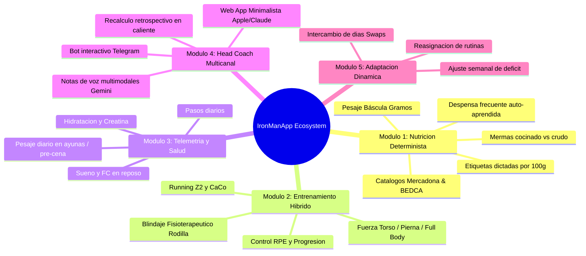

# 📘 Product Requirements Document (PRD) — IronManApp
**Versión:** 1.0.0  
**Fecha de Publicación:** 6 de Octubre de 2026  
**Liderazgo de Producto:** PLANNER & PRODUCT-LENS (Everything Claude Code ECC)  
**Estado:** Living Document (Fuente Oficial de Verdad / Single Source of Truth)  

---

## 1. VISIÓN DEL PRODUCTO Y CONTEXTO DEL ATLETA

### 1.1. Perfil del Atleta
* **Nombre:** Álvaro
* **Peso Inicial / Actual:** 101,0 kg exactos
* **Meta de Peso / Recomposición Corporal:** 85,0 kg – 88,0 kg
* **Gasto Energético Diario (TDEE):** 2.900 – 3.000 kcal
* **Objetivo Nutricional Base:** Déficit calórico moderado de **2.400 kcal/día** con ingesta hiperproteica fijada en **202 g de proteína/día** (~2.0 g/kg de masa corporal magra) para preservar masa muscular en microciclos de fuerza y running simultáneo.

### 1.2. Hito Maestro: La Media Maratón
* **Evento Clave:** Media Maratón (21,097 km) el **28 de Febrero de 2027**.
* **Periodización Global:** Macro-ciclo de 22 semanas de preparación progresiva estructurado en 4 fases (Blindaje Articular, Consolidación Aeróbica, Sobrecarga Específica y Tapering).
* **Descansos Fijos Semanales:** Miércoles y Sábados (cero impacto, regeneración del sistema nervioso y asimilación muscular).

### 1.3. Condicionante Biomecánico Crítico: Blindaje de Rodilla
* **Diagnóstico / Riesgo:** Estrés femororrotuliano e impacto articular de sobrecarga por peso corporal elevado (>100 kg) en carrera continua.
* **Directriz Fisioterapéutica Innegociable:**
  * **Cero dolor o inflamación al despertar.** Si aparece molestia en tendón rotuliano, se conmuta automáticamente la sesión a método CaCo (Caminar-Correr: 4 min trote suave @ 7:15 min/km + 1 min andar ágil) o marcha atlética inclinada.
  * **Cadencia obligatoria:** 165 – 172 ppm para reducir la oscilación vertical y el torque articular en aterrizaje.
  * **Fortalecimiento preventivo en gimnasio:** Trabajo prioritario de vasto interno (VMO), flexores de cadera, isquiosurales y glúteo medio para estabilizar el valgo dinámico.

### 1.4. Propuesta de Valor Diferencial
IronManApp no es un rastreador pasivo comercial (tipo MyFitnessPal o Strava aislado). Es un **Head Coach de Inteligencia Artificial Multimodal** que combina:
1. **Precisión Bromatológica Quirúrgica:** Catálogo oficial Mercadona/Hacendado, base de datos científica española BEDCA y cálculo aditivo determinista por báscula de cocina.
2. **Entrada Ultrarrápida por Voz:** Registro mediante audios naturales en Telegram o la App Web con desglose de pesajes y etiquetas por 100 g.
3. **Periodización Dinámica en Tiempo Real:** Ajustes semanales de calorías e intercambio flexible de días de entrenamiento ante imprevistos de vida o sobrecarga física.

---

## 2. MÓDULOS FUNCIONALES CLAVE (ÉPICAS Y USER STORIES)



---

### Módulo 1: Motor de Nutrición Determinista & Ingesta por Voz
* **Épica:** Permitir al atleta registrar cualquier ingesta alimentaria en lenguaje natural hablado o escrito, garantizando exactitud matemática sin números inventados por la IA.
* **Historias de Usuario:**
  * **US-1.1 (Desglose Aditivo de Ingredientes):** Como atleta, quiero dictar los ingredientes de una comida pesados en mi báscula (ej: "217g calabacín, 204g contramuslo y 10g aceite") para que la app sume individualmente los macronutrientes de cada alimento sin mezclar calorías.
  * **US-1.2 (Etiquetas Nutricionales por 100g Dictadas):** Como atleta, cuando consumo un producto específico cuya etiqueta tengo delante, quiero dictar sus valores por 100g (ej: "40g queso gouda que por 100g tiene 326 kcal, 25g grasa, 3.3g HC y 22g prot") para que el sistema calcule exactamente `(gramos / 100) * macro` y asigne esos datos a ese ingrediente concreto.
  * **US-1.3 (Mermas y Alimentos Cocinados vs Crudos):** Como atleta, quiero registrar alimentos ya cocinados (ej: "pechuga de pollo a la plancha" o "contramuslo cocinado") y que el motor aplique las tablas de concentración de nutrientes cocinados de Mercadona/BEDCA sin inventar carbohidratos en carnes limpias.
  * **US-1.4 (Memoria de Alimentos Frecuentes):** Como atleta, quiero que mis productos habituales queden guardados en mi despensa personal (`user_frequent_foods`) para resolución instantánea con máxima prioridad.

---

### Módulo 2: Planificación de Entrenamiento Híbrido (Fuerza + Running)
* **Épica:** Ejecutar una preparación híbrida equilibrada que desarrolle fuerza funcional y capacidad aeróbica para 21K sin interferencia negativa ni lesiones articulares.
* **Historias de Usuario:**
  * **US-2.1 (Estructura Semanal Fija):** Como atleta, quiero disponer de una planificación estructurada de 7 días:
    * *Lunes:* Fuerza Torso (Día de empujes/tirones, control escapular)
    * *Martes:* Fuerza Pierna enfocada en Rodilla (Cadena posterior, VMO, movilidad de tobillo)
    * *Miércoles:* Descanso Activo / Regeneración
    * *Jueves:* Carrera Continua Z2 / CaCo Corto (4–6 km suaves)
    * *Viernes:* Fuerza Full Body Funcional
    * *Sábado:* Descanso Total
    * *Domingo:* Tirada Larga Progresiva Z2 (5–16 km según fase de periodización)
  * **US-2.2 (Registro de Series y RPE):** Como atleta, quiero registrar mis levantamientos en el gimnasio indicando peso, repeticiones y RPE (esfuerzo percibido 1-10) para monitorizar la sobrecarga progresiva sin sobreentrenar.
  * **US-2.3 (Protocolos Clínicos de Rodilla):** Como atleta, quiero recibir advertencias biomecánicas inmediatas si intento correr con molestia articular o si la cadencia de carrera es subóptima.

---

### Módulo 3: Telemetría Diaria y Salud Metabólica
* **Épica:** Consolidar métricas biológicas para diagnosticar fatiga, retención de líquidos o necesidad de descarga.
* **Historias de Usuario:**
  * **US-3.1 (Pesaje Corporal Doble / Matutino y Pre-Cena):** Como atleta, quiero registrar mi peso diario (objetivo 101 kg $\to$ 85 kg) con notas de contexto (ej: "después de entrenar, antes de cenar").
  * **US-3.2 (Control de Pasos y Actividad):** Como atleta, quiero monitorizar mis pasos diarios según el tipo de día (objetivo: 10.000–12.000 en días de fuerza/cardio, 7.000–8.000 en descanso).
  * **US-3.3 (Hidratación y Creatina):** Como atleta, quiero registrar mi consumo de agua (mínimo 3.000 ml/día) y verificar el consumo de 5 g diarios de creatina monohidrato para proteger la fuerza intramuscular.

---

### Módulo 4: Asistente Multicanal Unificado (Head Coach IA)
* **Épica:** Interactuar con el mismo entrenador inteligente tanto desde el móvil en movimiento vía Telegram como desde el panel web de escritorio o móvil con UI minimalista.
* **Historias de Usuario:**
  * **US-4.1 (Notas de Voz en Telegram y Web):** Como atleta, quiero grabar un audio mientras preparo la comida y que el Coach lo procese en menos de 3.5 segundos devolviendo el desglose nutricional, consejo fisioterapéutico y calorías restantes del día.
  * **US-4.2 (Auditoría y Recálculo en Caliente):** Como atleta, si detecto un error en los cálculos de mis comidas de hoy, quiero poder decir *"recalcula las comidas de hoy a partir de mis audios"* o usar `/recalcular_comidas` para que el sistema re-procese los audios originales con la última base bromatológica y actualice Supabase en caliente.

---

### Módulo 5: Motor de Adaptación Dinámica (Swaps & Diet Adaptations)
* **Épica:** Permitir que el plan se adapte a la vida real del atleta, manteniendo la consistencia semanal total.
* **Historias de Usuario:**
  * **US-5.1 (Intercambio de Días):** Como atleta, si el jueves tengo una reunión y no puedo correr, quiero decir *"cambia el entreno del jueves con el del sábado"* para que el calendario, los objetivos de pasos y las demandas calóricas se intercambien automáticamente.
  * **US-5.2 (Reasignación de Rutinas):** Como atleta, quiero reasignar una sesión puntual a otra fecha sin perder el historial.
  * **US-5.3 (Adaptación Semanal de Déficit):** Como atleta, quiero que el sistema analice mi peso medio semanal y, si la bajada se estanca o es excesivamente agresiva, recomiende un ajuste de +/- 100 kcal en el objetivo diario.

---

## 3. CRITERIOS DE ACEPTACIÓN POR HISTORIA DE USUARIO (GHERKIN)

### Escenario A: Dictado de Comida Compleja con Pesajes y Etiquetas por 100g
```gherkin
Feature: Registro de Comidas con Etiquetas por 100g Dictadas por Voz

  Scenario: Álvaro dicta un desayuno compuesto de 5 ingredientes con 2 etiquetas de envase
    Given que el atleta Álvaro tiene configurado su objetivo diario en 2.400 kcal
    When Álvaro envía la nota de voz:
      """
      Finalmente, he usado un huevo que pesaba 54 g, 151 g de claras de huevo pasteurizadas, 
      20 g de espinacas, 40 g de queso mozzarella gouda rallado, que por 100 g tiene 326 calorías, 
      25 g de grasas, 3,3 g de hidratos de carbono y 22 g de proteína. Y después, 80 g de pechuga 
      de pavo en finas lonchas, que por 100 g tiene 76 calorías, 0,5 de grasas, 1,3 de hidratos 
      de carbono y 16,5 g de proteína. Todos estos valores antes de cocinar.
      """
    Then el motor de nutrición debe extraer exactamente 5 alimentos independientes
    And debe aplicar la escala (40/100) a la etiqueta del queso resultando en 130 kcal y 8.8g de proteína
    And debe aplicar la escala (80/100) a la etiqueta del pavo resultando en 61 kcal y 13.2g de proteína
    And debe resolver el huevo (54g), claras (151g) y espinacas (20g) con el catálogo Mercadona/BEDCA
    And las calorías totales del plato deben situarse entre 345 y 355 kcal
    And la proteína total debe situarse entre 45 y 47 g
    And el registro en Supabase "nutrition_logs" debe guardar el desglose aditivo sin sobrescribir macros
```

### Escenario B: Intercambio de Días de Calendario por Imprevisto o Molestia
```gherkin
Feature: Intercambio Dinámico de Días en el Calendario

  Scenario: Álvaro intercambia la sesión de carrera con el día de descanso
    Given que el jueves 2026-10-08 tiene programada la rutina "running_intervals"
    And el sábado 2026-10-10 tiene programado "rest_day"
    When Álvaro escribe o dice al Coach:
      "Intercambia el entrenamiento del jueves con el del sábado"
    Then el sistema debe registrar un override en "routine_day_overrides" para ambas fechas
    And el jueves 2026-10-08 debe quedar marcado como descanso con objetivo de 7.000 pasos
    And el sábado 2026-10-10 debe recibir la rutina de carrera con objetivo de 11.000 pasos
    And el Coach debe confirmar la adaptación en Telegram y en la App Web
```

### Escenario C: Auditoría y Recálculo Retrospectivo en Caliente
```gherkin
Feature: Auditoría y Recálculo de Comidas del Día

  Scenario: El atleta solicita re-auditar las comidas registradas tras detectar un fallo
    Given que existen comidas registradas para la fecha de hoy en "nutrition_logs"
    When Álvaro envía el comando "/recalcular_comidas" o el mensaje "recalcula las comidas de hoy"
    Then el sistema debe recuperar las transcripciones literales originales de cada comida
    And debe re-procesar cada plato con el pipeline determinista en 3 capas
    And debe actualizar los registros en Supabase con las calorías y macronutrientes corregidos
    And debe emitir un informe comparativo mostrando el total anterior vs corregido y el impacto neto
```

---

## 4. MÉTRICAS DE ÉXITO Y KPIs DE PRODUCTO

| Métrica / KPI | Objetivo / Meta | Frecuencia de Medición | Tolerancia Aceptada |
| :--- | :--- | :--- | :--- |
| **Precisión Bromatológica** | $\Delta \le 15\text{ kcal}$ respecto a la suma metabólica ($4P + 4C + 9G$) | En cada comida registrada | Cero discrepancia en alimentos pesados con etiqueta |
| **Tasa de Descenso de Peso** | $-0.5\text{ a }-0.8\text{ kg / semana}$ | Media móvil semanal (7 días) | Si $\Delta > -1.0\text{ kg}$, riesgo de merma muscular; si $\Delta < 0$, ajustar déficit |
| **Adherencia a la Proteína** | $\ge 190\text{ g / día}$ (Meta: 202 g) | Diario | Mínimo 90% de los días del mes en meta |
| **Salud Articular de Rodilla** | **0 días de parón por dolor agudo** | Continuo | Escala de dolor matutino rotuliano $= 0/10$ |
| **Latencia de Respuesta del Coach** | $< 3.5\text{ segundos}$ en notas de voz | Por interacción | 99% de las notas de voz procesadas antes de 4s |
| **Cadencia Media en Carrera Z2** | $165\text{ – }172\text{ ppm}$ | Por sesión de running | Desviación inferior al 3% |

---

## 5. ROLES Y USUARIOS
* **Atleta Titular (Usuario Único Primario):** Álvaro (acceso autenticado con PIN / biometría en Web y chat privado vinculado en Telegram mediante `TELEGRAM_CHAT_ID`).
* **Head Coach IA (Agente Autónomo):** Sistema de inteligencia artificial alimentado por Gemini Flash y reglas fisioterapéuticas/bromatológicas deterministas.

---
*Fin del Product Requirements Document (PRD)*
