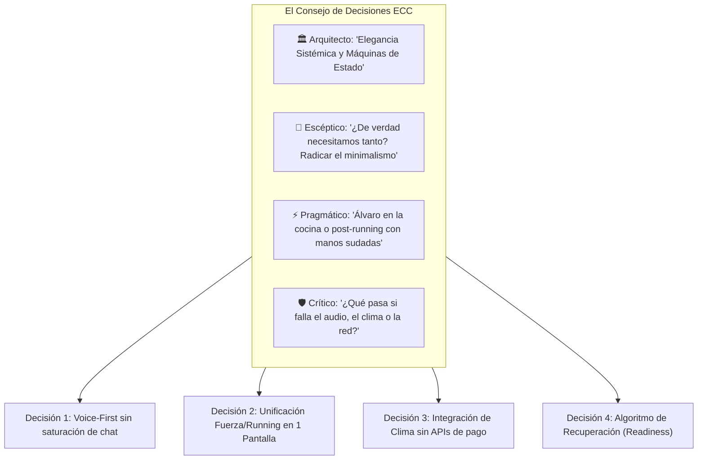
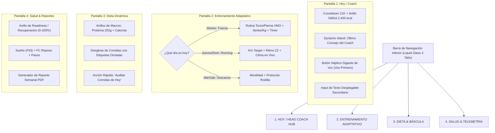

# 💎 Blueprint de Rediseño Integral: IronManApp "Liquid Glass Edition"
**Liderazgo de Ingeniería:** COUNCIL, ARCHITECT, UX/UI ARCHITECT & REVIEWERS (Everything Claude Code ECC)  
**Fecha:** 6 de Octubre de 2026  
**Inspiración Estética:** Apple iOS Human Interface Guidelines / Liquid Glass Translucent Materials  
**Filosofía:** *Voice-First, Radical Simplicity, Zero Dashboard Fatigue, Pure Ergonomics.*

---

## 1. 🏛️ DICTAMEN DEL CONSEJO (THE COUNCIL: 4 VOCES)

Antes de abordar cualquier línea de código, se convocó al **COUNCIL de ECC** para debatir los dilemas de arquitectura y producto:



### Debate 1: Voice-First vs. Chat Tradicional tipo WhatsApp
* **El Arquitecto:** *"Debemos desacoplar la voz del renderizado de mensajes largos. La voz es un canal de mutación del estado del día, no solo un diálogo."*
* **El Escéptico:** *"Un chat convencional con scroll infinito fatiga la vista y rompe el minimalismo. El usuario no quiere leer un muro de texto, quiere ver el impacto en sus números."*
* **El Pragmático:** *"Álvaro necesita un botón flotante háptico enorme para su pulgar. Habla mientras cocina o corre, suelta y ve la tarjeta con el resultado. Si quiere escribir, un botón secundario abre un input deslizante de una sola línea."*
* **El Crítico:** *"Si el navegador no tiene permiso de micro o falla la red, el usuario no puede quedar bloqueado. El fallback a texto debe ser instantáneo y el audio no debe perderse si la conexión parpadea."*
* **Veredicto del Consejo:** **Aprobado.** La pantalla principal NO será un chat de texto. Será un **Head Coach Hub** con un botón de grabación háptico central/inferior, una **Dynamic Island / Action Pill** que muestra el último feedback del Coach, y un resumen ejecutivo limpio del día.

### Debate 2: Pestaña Unificada de Entrenamiento Adaptativa
* **El Arquitecto:** *"Tener pestañas separadas de Cardio y Fuerza fragmenta el modelo mental. El entrenamiento es uno solo por día y debe ser gobernado por una máquina de estados: `StrengthSessionView` o `RunningSessionView` según `todayRoutine.dayType`."*
* **El Escéptico:** *"Reducir de 5 a 4 pestañas en la barra inferior (Hoy, Entreno, Dieta, Salud) es una victoria rotunda de ergonomía: botones más anchos, menos ruido y navegación natural."*
* **El Pragmático:** *"Debe haber un toggle sutil ('Cambiar modalidad') por si Álvaro decide hoy cambiar la carrera por gimnasio sin tener que decírselo al bot obligatoriamente."*
* **El Crítico:** *"El calendario debe funcionar offline. Si Supabase no responde, la app debe saber qué toca hoy usando la matriz estática de `weeklyRoutine.ts`."*
* **Veredicto del Consejo:** **Aprobado al 100%.** Se fusionan en la pestaña `Entrenamiento`, que transmuta visualmente según el día.

### Debate 3: Integración Meteorológica (Weather Engine)
* **El Arquitecto:** *"Open-Meteo API: Gratuita, sin API key, soporte de coordenadas de España, latencia <120 ms, devuelve lluvia, temperatura y viento."*
* **El Escéptico:** *"Prohibido meter un widget meteorológico gigante con pronósticos a 7 días. Solo una píldora translúcida con la información crítica para correr: temperatura, lluvia y alerta articular."*
* **El Crítico:** *"Si el atleta deniega la ubicación en el móvil, el sistema debe usar por defecto Madrid o la última ubicación guardada sin lanzar errores."*
* **Veredicto del Consejo:** **Aprobado.** Mini-widget inteligente integrado exclusivamente en los días de Running, con advertencias fisiológicas automáticas (*"Asfalto mojado: eleva cadencia a 170 ppm para proteger rodilla"*).

---

## 2. 🎨 SISTEMA DE DISEÑO: APPLE LIQUID GLASS (iOS 26/27)

### 2.1. Tokens de Materiales y Translucidez
```css
/* Tokens de Estilo Liquid Glass para Tailwind CSS */
.liquid-glass-card {
  background: rgba(255, 255, 255, 0.08);
  backdrop-filter: blur(24px) saturate(180%);
  -webkit-backdrop-filter: blur(24px) saturate(180%);
  border: 1px solid rgba(255, 255, 255, 0.14);
  box-shadow: 0 8px 32px 0 rgba(0, 0, 0, 0.25);
}

.liquid-glass-pill {
  background: rgba(255, 255, 255, 0.12);
  backdrop-filter: blur(16px);
  border: 1px solid rgba(255, 255, 255, 0.2);
}

.liquid-glass-glow-emerald {
  box-shadow: 0 0 25px -5px rgba(16, 185, 129, 0.35);
}

.liquid-glass-glow-cyan {
  box-shadow: 0 0 25px -5px rgba(6, 182, 212, 0.35);
}
```

### 2.2. Paleta Cromática y Jerarquía Visual
* **Fondo:** Dark Obsidian profundo (`#0B0E14` con gradientes radiales muy sutiles en `#111827`).
* **Tipografía:** SF Pro Display / Inter con `tracking-tight` y pesos calibrados (`font-semibold` para métricas, `font-normal` para leyendas).
* **Colores de Acento Semánticos:**
  * 🟢 **Emerald (`#10B981`):** Nutrición exacta, proteína completada, articulación sana.
  * 🔵 **Electric Cyan (`#06B6D4`):** Running Z2, hidratación, volumen aeróbico.
  * 🟣 **Ultra Violet (`#8B5CF6`):** Fuerza, levantamientos de pesas, RPE.
  * 🟡 **Warm Amber (`#F59E0B`):** Precaución meteorológica, descanso activo, refeed.
  * 🔴 **Crimson Alert (`#EF4444`):** Dolor articular, sobrecarga detectada.

---

## 3. 📱 ARQUITECTURA DE LAS 4 PANTALLAS CENTRALIZADAS



---

## 4. 🧩 ESPECIFICACIÓN DETALLADA POR PANTALLA

### Pantalla 1: Hoy / Head Coach Hub (Voice-First Master)
1. **Header Ejecutivo:**
   * Cuenta atrás a la Media Maratón: `145 DÍAS · FASE 1: BLINDAJE ARTICULAR`.
   * Peso actual: `101,0 kg` con chip de tendencia semanal.
2. **Dynamic Island del Coach:**
   * Una píldora flotante que muestra el estado actual:
     * *“Desayuno registrado con 349 kcal y 46g de proteína. Te quedan 2.051 kcal para hoy.”*
     * Al pulsar, se expande suavemente con una transición spring para ver el histórico de interacciones recientes.
3. **Tarjeta de Balance Calórico & Agua (Liquid Glass):**
   * Gráfico de barra horizontal de 3 segmentos con blur:
     * Consumidas: `349 kcal` / Restantes: `2.051 kcal` (Meta: `2.400 kcal`).
     * Proteína: `46 g / 202 g` (Barra esmeralda vibrante).
     * Agua: Acceso rápido `+250ml` / `+500ml`.
4. **Zona de Acción Inferior Ergonómica:**
   * **Botón Central Flotante de Grabación de Voz:**
     * Icono de micrófono sobredimensionado con anillo de pulso respiratorio (haptic feedback visual).
     * Pulsar para hablar / mantener presionado.
     * Al soltar, envía el audio a `/api/coach/message` con feedback de carga tipo *"Escuchando y calculando con Mercadona..."*.
   * **Botón Secundario de Teclado:** Un icono minimalista a la derecha que desliza suavemente un input de texto para situaciones silenciosas.

---

### Pantalla 2: Entrenamiento Adaptativo (Unificado & Transmutable)
1. **Cabecera de Modalidad con Toggle Suave:**
   * Título dinámico: `MARTES · FUERZA PIERNA (BLINDAJE DE RODILLA)` o `JUEVES · CARRERA CONTINUA Z2 (CACO 4+1)`.
   * Chip discreto a la derecha: `[Modificar sesión]` para intercambiar con otro día del calendario.
2. **Si el día es FUERZA:**
   * Lista de ejercicios interactiva (Tarjeta translúcida por ejercicio):
     * Ej: *Prensa Inclinada (VMO)* $\to$ Series completadas con chips interactivos (`4x12 @ 120kg · RPE 8`).
     * Botón `+ Añadir Serie` rápido.
     * Temporizador de descanso flotante automático al registrar una serie (90s / 120s).
3. **Si el día es RUNNING (Carrera Z2 / Tirada Larga):**
   * **Tarjeta Meteorológica Integrada (Open-Meteo Engine):**
     * `19°C · Parcialmente Nublado · 62% Humedad · Viento 12 km/h`.
     * **Consejo Biomecánico:** *"Asfalto seco. Mantén cadencia a 168 ppm para aterrizar bajo el centro de gravedad."*
     * Si llueve: *"🌧️ Lluvia detectada: asfalto deslizante. Reduce longitud de zancada para proteger la rótula."*
   * **Métricas Objetivas del Entrenamiento:**
     * Distancia: `5,0 km` (Objetivo CaCo: 4 min trote @ 7:15 + 1 min andar).
     * Frecuencia Cardíaca Objetivo: `132 – 144 bpm` (Zona 2 pura).
4. **Si el día es DESCANSO / REGENERACIÓN:**
   * Guía visual de estiramientos de cadena posterior y protocolo de hielo/foam roller para la rodilla.

---

### Pantalla 3: Dieta & Báscula (Nutrición Determinista)
1. **Resumen de Macros del Día:**
   * 4 tarjetas compactas Liquid Glass:
     * 🔥 **Calorías:** `349 / 2.400 kcal`
     * 🥩 **Proteína:** `46,0 / 202 g`
     * 🍚 **Carbohidratos:** `3,8 / 220 g`
     * 🥑 **Grasa:** `16,2 / 65 g`
2. **Timeline de Comidas del Día:**
   * Cada comida registrada (Desayuno, Almuerzo, Cena, Snacks) con:
     * Nombre descriptivo y hora.
     * Totales de macros.
     * Desglose desplegable con los ingredientes pesados y la fuente (`🏷️ Etiqueta dictada`, `🟢 Mercadona`, `🟣 BEDCA`).
3. **Acciones de Auditoría:**
   * Botón superior: `🔄 Auditar y Recalcular Día` (invoca `recalculateDayNutrition`).

---

### Pantalla 4: Salud, Telemetría & Reportes
1. **Score de Asimilación & Recuperación (Readiness 0-100%):**
   * Anillo central Liquid Glass que computa algorítmicamente:
     $$\text{Readiness} = 0.40 \times \text{SleepScore} + 0.35 \times \text{RestingHRScore} + 0.25 \times \text{StepRecoveryScore}$$
   * Diagnóstico: *“92% · Estado Óptimo para Sobrecarga”* o *“68% · Fatiga Acumulada: Prioriza descanso y proteína”*.
2. **Métricas de la Galaxy Fit3 / Dispositivo:**
   * Sueño: Horas totales, sueño profundo, sueño REM y despertar.
   * Frecuencia Cardíaca en Reposo: Gráfico de tendencia semanal.
   * Pasos Acumulados: Barra de progreso hacia la meta del día (11.000 pasos).
3. **Centro de Reportes:**
   * Botón de cabecera: `📄 Generar Reporte Semanal PDF`.
   * Vista previa de cumplimiento calórico, curva de peso corporal y volumen total de carrera acumulado.

---

## 5. 🛠️ ESPECIFICACIÓN TÉCNICA DEL MOTOR METEOROLÓGICO Y READINESS

### 5.1. Weather Service (`src/lib/weather/weatherService.ts`)
```typescript
export interface WeatherCondition {
  temperature_c: number;
  humidity_pct: number;
  weather_code: number;
  is_raining: boolean;
  wind_kmh: number;
  surface_risk: 'seco_optimo' | 'humedo_precaucion' | 'mojado_resbaladizo';
  runner_tip: string;
}

export async function getLiveRunningWeather(lat = 40.4168, lon = -3.7038): Promise<WeatherCondition> {
  const url = `https://api.open-meteo.com/v1/forecast?latitude=${lat}&longitude=${lon}&current=temperature_2m,relative_humidity_2m,weather_code,wind_speed_10m`;
  const res = await fetch(url, { next: { revalidate: 1800 } }); // Cache 30 min
  const data = await res.json();
  const current = data.current;

  const isRaining = [51, 53, 55, 61, 63, 65, 80, 81, 82].includes(current.weather_code);
  const surfaceRisk = isRaining ? 'mojado_resbaladizo' : (current.relative_humidity_2m > 85 ? 'humedo_precaucion' : 'seco_optimo');

  let tip = 'Condiciones óptimas. Mantén cadencia constante de 168-172 ppm.';
  if (isRaining) {
    tip = '🌧️ Asfalto resbaladizo. Acorta la zancada y extrema precaución en apoyos para evitar torsión de rodilla.';
  } else if (current.temperature_2m > 25) {
    tip = '☀️ Calor elevado. Añade +500 ml de agua con electrolitos y modera el ritmo en Z2.';
  }

  return {
    temperature_c: Math.round(current.temperature_2m),
    humidity_pct: current.relative_humidity_2m,
    weather_code: current.weather_code,
    is_raining: isRaining,
    wind_kmh: Math.round(current.wind_speed_10m),
    surface_risk: surfaceRisk,
    runner_tip: tip,
  };
}
```

### 5.2. Algoritmo de Readiness & Salud
```typescript
export function calculateHealthReadiness(
  sleepScore: number | null,
  restingHr: number | null,
  baselineHr = 55
): { score: number; status: 'optimo' | 'moderado' | 'fatigado'; advice: string } {
  const sleepWeight = 0.55;
  const hrWeight = 0.45;

  const effectiveSleep = sleepScore || 75;
  let hrScore = 80;
  if (restingHr) {
    const hrDiff = restingHr - baselineHr;
    hrScore = Math.max(30, Math.min(100, 85 - hrDiff * 5));
  }

  const score = Math.round(effectiveSleep * sleepWeight + hrScore * hrWeight);

  if (score >= 80) {
    return { score, status: 'optimo', advice: 'Sistema nervioso recuperado. Listo para la intensidad programada.' };
  } else if (score >= 65) {
    return { score, status: 'moderado', advice: 'Recuperación adecuada. Respeta estrictamente los ritmos de Zona 2.' };
  } else {
    return { score, status: 'fatigado', advice: 'Fatiga detectada. Considera cambiar carrera por marcha o añadir descanso extra.' };
  }
}
```

---

## 6. 🚀 PLAN DE EJECUCIÓN (SPRINTS RECOMENDADOS)

1. **Sprint 1 — Core Layout & BottomNav Refactor:**
   * Rediseñar la navegación a 4 pestañas: `Hoy`, `Entrenamiento`, `Dieta`, `Salud`.
   * Implementar los tokens base de Tailwind `liquid-glass-card` y `backdrop-blur`.
2. **Sprint 2 — Voice-First Hub en Pantalla Principal:**
   * Botón de micrófono háptico central con Web Audio API.
   * Dynamic Island del Coach para mostrar feedback inmediato sin saturar de mensajes.
3. **Sprint 3 — Pestaña de Entrenamiento Adaptativa + Weather Engine:**
   * Integración de `getLiveRunningWeather` con Open-Meteo.
   * Renderizado condicional automático: Fuerza vs Running vs Descanso con un solo tap de conmutación.
4. **Sprint 4 — Dashboard de Salud & Generación PDF:**
   * Anillo de Readiness interactivo.
   * Vista ejecutiva de balance semanal imprimible/exportable.

---

## 7. 📐 SPEC SHEET DE DISEÑO, RESPONSIVE UNIVERSAL & ACCESIBILIDAD (WCAG 2.2)

> **Documento Detallado de Referencia:** Ver pliego completo en [`docs/UI_UX_SPEC_SHEET.md`](file:///c:/Users/alvar/Desktop/Projects/IronManApp/docs/UI_UX_SPEC_SHEET.md).  
> **Documento de Backend & APIs:** Ver especificación técnica en [`docs/TRD.md`](file:///c:/Users/alvar/Desktop/Projects/IronManApp/docs/TRD.md).

### 7.1. Tabla de Especificaciones Físicas y Tokens de Componentes

| Componente | Clases Clave | Dimensiones / Radios | Comportamiento Táctil & Ergonómico |
| :--- | :--- | :--- | :--- |
| **TopBar (Cabecera)** | `sticky top-0 z-40 liquid-glass-nav h-16 pt-[safe-top]` | Alto: 64px + Inset | Fija, con blur de 30px y bisel superior; compatible con Dynamic Island y notch. |
| **BottomNav (Navegación)** | `fixed bottom-0 z-50 liquid-glass-nav h-16 pb-[safe-bottom]` | Alto: 64px + Inset | 4 pestañas ergonómicas (`Hoy`, `Entreno`, `Dieta`, `Salud`) en el arco del pulgar. |
| **HeroVoiceButton** | `w-20 h-20 rounded-full liquid-glass-card` | 80 × 80 px | Botón circular de gran formato para pulsación háptica ciega cocinando o corriendo. |
| **Tarjetas de Datos** | `liquid-glass-card rounded-3xl p-5` | Radio: 24px (Squircle) | Fondo translúcido (72% en Light / 65% en Dark) con bisel especular cenital de 1px. |
| **Dynamic Island Coach**| `liquid-glass-pill px-4 py-2 text-xs` | Radio completo 9999px | Cápsula flotante reactiva con feedback en tiempo real sin saturar de chat. |

### 7.2. Matriz Responsive Universal

1. **Móviles Compactos (360px – 390px — iPhone SE, Galaxy A/S, Redmi, Huawei):**
   - Ancho 100% con `px-3.5`. Títulos escalados de 24px a 20px para evitar desbordes en datos metabólicos.
   - Respeto riguroso de `safe-area-inset-bottom` para evitar solapamientos con la botonera de Android.
2. **Móviles Pro / Max (393px – 430px — iPhone 15/16 Pro Max, Galaxy S24 Ultra):**
   - Contenedor centrado `max-w-md mx-auto`. Altura de cabecera adaptada a la Dynamic Island nativa.
3. **Tablets & Plegables (768px – 1024px — iPad, Galaxy Fold):**
   - Layout fluido de 2 columnas: Columna izquierda con Coach Hub (40%) y columna derecha con rutina/nutrición (60%).
4. **Escritorio Web 1080p (FHD), 2K (QHD) y 4K (UHD):**
   - Prohibido estirar la app a pantalla completa panorámica.
   - Se presenta como un **"Command Deck Centralizado"** con marco de cristal líquido de 480px a 540px de ancho (`max-w-lg mx-auto`), rodeado por un fondo ambiental con gradientes radiales difusos.
   - Atajos de teclado de escritorio: `Espacio` para hablar, números `1-4` para navegar pestañas, tecla `T` para alternar modo claro/oscuro.

### 7.3. Certificación de Accesibilidad (WCAG 2.2 AA / AAA)

- **Ratios de Contraste:** 
  - Light Mode: `#141413` sobre cristal Ivory = **14.8:1 (Cumple AAA)**.
  - Dark Mode: `#FAF9F6` sobre cristal Obsidian = **16.2:1 (Cumple AAA)**.
- **Tamaños Táctiles:** Todos los botones interactivos miden como mínimo 44×44px (iOS) o 48×48px (Android), con el botón de voz heroico a 80×80px.
- **Modos de Adaptación del Sistema:**
  - `prefers-contrast: more`: Desactiva desenfoques y refuerza bordes perimetrales a 2px sólidos.
  - `prefers-reduced-motion`: Desactiva animaciones y ondas de audio, aplicando transiciones inmediatas.
  - `aria-live="polite"`: Anuncia el feedback del Coach en lectores de pantalla de forma no intrusiva.

---
*Fin del Blueprint de Rediseño Integral de IronManApp (Liquid Glass Edition)*
