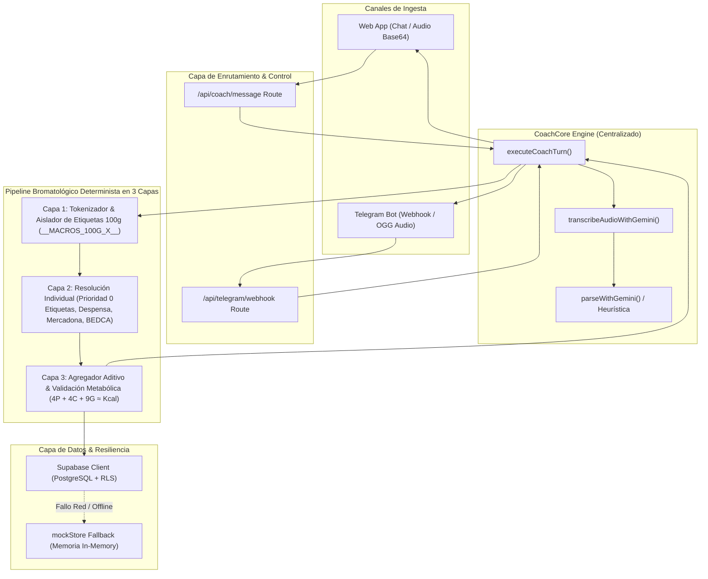
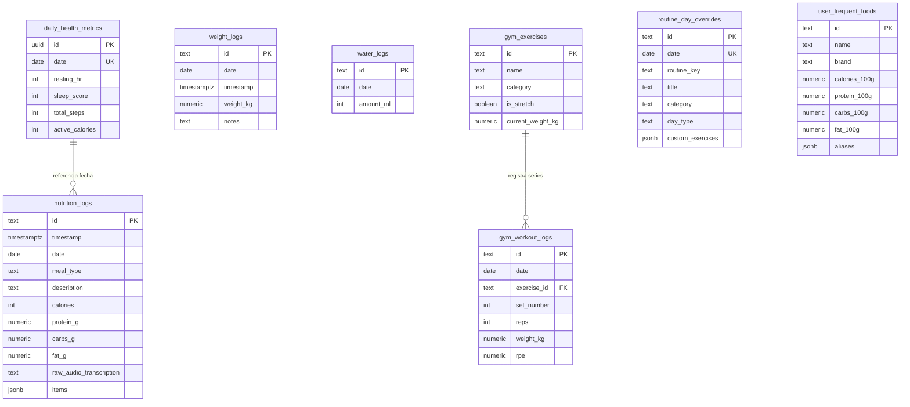
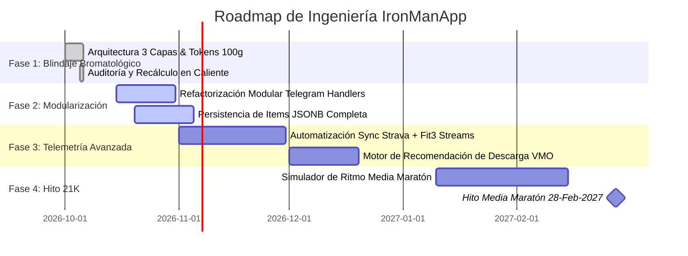

# 🛠️ Technical Requirements Document (TRD) — IronManApp
**Versión:** 1.0.0  
**Fecha de Publicación:** 6 de Octubre de 2026  
**Liderazgo de Arquitectura:** ARCHITECT, DATABASE-REVIEWER & ADR SPECIALIST (Everything Claude Code ECC)  
**Estado:** Living Document (Fuente Oficial de Verdad / Single Source of Truth)  

---

## 1. ARQUITECTURA GENERAL DEL SISTEMA

### 1.1. Stack Tecnológico de Referencia
* **Framework Web:** Next.js 14.2+ (App Router con Server Components y Route Handlers).
* **Lenguaje:** TypeScript 5.0+ (Modo estricto `strict: true`, prohibición de tipos `any` injustificados).
* **Diseño e Interfaz UI:** Tailwind CSS (clases de utilidad puras, microinteracciones estilo iOS / Claude Minimal, accesibilidad con una sola mano en móvil).
* **Base de Datos & Backend como Servicio (BaaS):** Supabase (PostgreSQL 15+ con extensión `pgcrypto`, Row Level Security y API REST / PostgREST).
* **Motor de Inteligencia Artificial:** Google Gemini Multimodal (`gemini-flash-latest`, fallback a `gemini-2.0-flash` y `gemini-3.5-transcribe` para procesamiento de audio).
* **Canales de Interacción:** 
  1. Telegram Bot API (Webhooks autenticados, notas de voz en formato OGG/Opus y mensajes de texto).
  2. Web App Centralizada (`/api/coach/message`, grabación de audio en el navegador y reproductor reactivo).
* **Harness de Ingeniería & Calidad:** Everything Claude Code (ECC) con `node:test` y `tsx` para pruebas TDD de regresión.

---

### 1.2. Diagrama de Flujo de Datos Multimodal Unificado



---

## 2. ARQUITECTURA DE CÁLCULO NUTRICIONAL EN 3 CAPAS

Para solucionar de raíz los errores de agregación observados cuando el atleta dicta comidas con múltiples ingredientes y etiquetas nutricionales por 100 g, el sistema implementa una **arquitectura en 3 capas puramente aditiva y determinista**:

```mermaid
sequenceDiagram
    autonumber
    actor Atleta as Álvaro (Audio / Texto)
    participant Tokenizer as Capa 1: Tokenizador Léxico
    participant Resolver as Capa 2: Resolución Bromatológica
    participant Aggregator as Capa 3: Agregador Matemático
    participant Database as Supabase (nutrition_logs)

    Atleta->>Tokenizer: "40g queso gouda que por 100g tiene 326 kcal, 22g prot... y 80g pavo..."
    Note over Tokenizer: Aisla cláusula "que por 100g..." -> Guarda en Map -> Inserta __MACROS_100G_0__
    Tokenizer->>Resolver: Array de WeighedItemInput con { food, amount, explicit_macros_100g }
    
    loop Para cada ingrediente
        alt Tiene explicit_macros_100g (Prioridad 0)
            Resolver->>Resolver: factor = amount / 100; Kcal = explicit.kcal * factor; Prot = explicit.prot * factor
        else Sin etiqueta dictada
            Resolver->>Resolver: Buscar en user_frequent_foods -> MERCADONA_CATALOG -> BEDCA -> IA
            Resolver->>Resolver: applyNutritionalSanityChecks (0g HC en carnes, etc.)
        end
    end

    Resolver->>Aggregator: CalculatedItemResult[] individuales
    Aggregator->>Aggregator: Sum(Kcal), Sum(P), Sum(HC), Sum(G)
    Aggregator->>Aggregator: Armonización 4*P + 4*HC + 9*G
    Aggregator->>Database: INSERT con desglose y JSONB items
    Aggregator-->>Atleta: Desglose visual detallado por alimento con iconos de fuente
```

### 2.1. Capa 1: Tokenizador Léxico y Aislador de Etiquetas por 100g
* **Archivo de Referencia:** [`src/lib/mercadonaNutrition.ts`](file:///c:/Users/alvar/Desktop/Projects/IronManApp/src/lib/mercadonaNutrition.ts#L2460)
* **Problema que resuelve:** Evita que números dictados pertenecientes a la etiqueta de un producto (ej: *"que por 100 g tiene 326 calorías..."*) se confundan con la cantidad pesada de un nuevo ingrediente o sobrescriban las calorías de toda la comida.
* **Mecanismo:**
  1. Detecta la cláusula mediante la expresión regular `labelPattern`:
     ```typescript
     const labelPattern = /(?:,\s*|\.\s*|\s+)?(?:que\s+)?(?:por\s+(?:cada\s+)?100\s*(?:g|gr|gramos)?(?:\s*de\s+producto)?|(?:los\s+)?valores\s+por\s+100\s*(?:g|gr|gramos)?)\s*(?:tiene|son|marca|pone|es|de)?\s*([^.]+?)(?=(?:\.(?:\s+|$)|;\s*|\s+(?:y\s+)?(?:después|luego|además)\b|$))/gi;
     ```
  2. Extrae los valores numéricos mediante `parseMacros100gFromText`.
  3. Reemplaza la cláusula en el flujo de texto por un identificador temporal `__MACROS_100G_${tokenIdx}__`.
  4. Segmenta el texto limpio por pesajes gramaticales, asociando el token al ingrediente que lo precede.
  5. Limpia los nombres de prefijos conversacionales mediante `cleanFoodName` (`"un huevo que pesaba"` $\to$ `"huevo"`).

### 2.2. Capa 2: Motor de Resolución Bromatológica Individual
* **Archivo de Referencia:** [`src/lib/mercadonaNutrition.ts`](file:///c:/Users/alvar/Desktop/Projects/IronManApp/src/lib/mercadonaNutrition.ts#L2215)
* **Cadena de Responsabilidad (Prioridades):**
  * **Prioridad 0 (Suprema):** `explicit_macros_100g`. Si el usuario dictó los macros del envase, se calcula estrictamente:
    $$\text{factor} = \frac{\text{amount}}{100}$$
    $$\text{calories} = \text{round}(\text{macros.calories} \times \text{factor})$$
    $$\text{protein\_g} = \text{round}_{1\text{dec}}(\text{macros.protein\_g} \times \text{factor})$$
    Retorna con `source: 'etiqueta_dictada'`.
  * **Prioridad 1:** Despensa personal de alimentos frecuentes (`user_frequent_foods`).
  * **Prioridad 2:** Catálogo maestro oficial de Mercadona (`MERCADONA_CATALOG`).
  * **Prioridad 3:** Base bromatológica científica BEDCA / USDA (`getScientificReferenceNutrition`).
  * **Prioridad 4:** Estimación asistida por IA Gemini (`heuristica_ia`).
  * **Prioridad 5:** Consulta externa a Open Food Facts (`searchOpenFoodFacts`).
* **Auditoría Fisiológica Inmutable (`applyNutritionalSanityChecks`):**
  * Siempre **clona** el producto antes de modificarlo para garantizar la inmutabilidad del catálogo estático en memoria.
  * Carnes, aves y pescados sin rebozar tienen **0.0 g de carbohidratos** obligatorios.
  * Verduras acuosas (calabacín, pepino, espinaca) tienen un tope estricto de **25 kcal / 100g**.
  * Aceites puros (AOVE) registran **0g proteína, 0g carbohidratos, 91.6g grasa y 824 kcal/100g**.

### 2.3. Capa 3: Agregador Aditivo y Validación Metabólica
* **Archivo de Referencia:** [`src/lib/mercadonaNutrition.ts`](file:///c:/Users/alvar/Desktop/Projects/IronManApp/src/lib/mercadonaNutrition.ts#L2370)
* **Cálculo:**
  $$\text{Total\_P} = \sum_{i} P_i, \quad \text{Total\_HC} = \sum_{i} HC_i, \quad \text{Total\_G} = \sum_{i} G_i$$
  $$\text{RawMathCalories} = \text{round}(4 \times \text{Total\_P} + 4 \times \text{Total\_HC} + 9 \times \text{Total\_G})$$
* **Armonización de Coherencia:** Si la suma de calorías individuales difiere en más de 15 kcal respecto a `RawMathCalories` por redondeos de productos, se armoniza con la fórmula metabólica para que el panel de usuario cuadre al 100%.

---

## 3. MODELO DE DATOS Y ESQUEMA SUPABASE (POSTGRESQL)

El esquema reside en [`supabase/schema.sql`](file:///c:/Users/alvar/Desktop/Projects/IronManApp/supabase/schema.sql) y utiliza la extensión `pgcrypto`.

### 3.1. Tablas Maestras del Dominio



### 3.2. Estrategia de Índices y Rendimiento

| Tabla | Índice | Columnas | Justificación Técnica |
| :--- | :--- | :--- | :--- |
| `nutrition_logs` | `idx_nutrition_date` | `date DESC` | Consultas de totales del día y agregación semanal por rango. |
| `weight_logs` | `idx_weight_date` | `date DESC` | Obtención instantánea del último peso corporal registrado (`LIMIT 1`). |
| `daily_health_metrics` | `idx_daily_health_date` | `date DESC` | Consultas de pasos diarios y sincronización de telemetría. |
| `gym_workout_logs` | `idx_gym_logs_date` | `date DESC` | Carga de entrenamientos por fecha. |
| `gym_workout_logs` | `idx_gym_logs_exercise` | `exercise_id` | Historial de progresión de cargas y 1RM estimado por ejercicio. |
| `routine_day_overrides`| `idx_routine_overrides_date`| `date DESC` | Intercambio de rutinas y detección de adaptaciones en el calendario. |
| `user_frequent_foods` | `idx_frequent_foods_name` | `name` | Búsqueda por coincidencia de nombre o alias habitual. |

### 3.3. Políticas RLS (Row Level Security) y Seguridad
* **Estado:** RLS habilitado en todas las tablas (`ALTER TABLE ... ENABLE ROW LEVEL SECURITY`).
* **Modelo de Permisos:**
  * **Service Role:** Acceso total (`FOR ALL USING (true)`). Utilizado por Next.js API Routes y Webhooks mediante `SUPABASE_SERVICE_ROLE_KEY`.
  * **Anon Key:** Lectura restringida para clientes frontend. Mutaciones prohibidas fuera de API Routes autenticadas.

---

## 4. INTEGRACIÓN DE INTELIGENCIA ARTIFICIAL Y RESILIENCIA

### 4.1. Pipeline de Modelos Gemini
1. **Modelo de Transcripción:** `gemini-3.5-transcribe` (modelo especializado ultrarrápido).
2. **Modelos de Inferencia y Razonamiento Multimodal:**
   * Primario: `gemini-flash-latest` (alta velocidad y precisión en JSON estructurado).
   * Fallback 1: `gemini-flash-lite-latest`.
   * Fallback 2: `gemini-2.0-flash`.

### 4.2. Ingesta de Audio Nativa en Memoria
* Las notas de voz capturadas en la Web o descargadas de Telegram se convierten a buffer base64 en memoria con su MIME type (`audio/ogg`, `audio/webm`, `audio/mp4`).
* Se inyectan directamente como `inline_data` en el contenido de la petición a la API de Gemini, eliminando la necesidad de guardar archivos temporales en disco y minimizando I/O.

### 4.3. Resiliencia y Fallback Offline Transparente
* Si Supabase no está configurado o sufre latencia/corte de red, la capa de acceso a datos conmuta automáticamente a [`mockStore`](file:///c:/Users/alvar/Desktop/Projects/IronManApp/src/lib/mockStore.ts) en memoria.
* Todas las funciones de mutación (`recalculateDayNutrition`, `executeCoachTurn`) actualizan en paralelo tanto la base de datos como el store en memoria para garantizar continuidad operativa sin errores 500.

---

## 5. REQUISITOS NO FUNCIONALES (NFRs)

### 5.1. Rendimiento y Latencia
* **Tiempo de Respuesta en Notas de Voz:** $< 3.5\text{ segundos}$ en el 95% de las interacciones completas (Descarga Telegram $\to$ Transcripción Gemini $\to$ Resolución Bromatológica $\to$ Escritura DB $\to$ Notificación).
* **Bundle Size Web:** Tamaño de primer viaje (First Load JS) $\le 88\text{ kB}$ por chunk compartido.

### 5.2. Concurrencia e Idempotencia en Webhooks
* El webhook de Telegram responde inmediatamente con HTTP 200 tras la validación de seguridad.
* El procesamiento de audios extensos utiliza mecanismos de actualización atómica por ID único (`nutri-${timestamp}`).

### 5.3. Calidad de Código y Estándares
* **Tipado Estricto:** Prohibido el uso de `any` en funciones críticas de cálculo. Todas las respuestas de la IA deben validarse contra interfaces tipadas (`UniversalAssistantResponse`, `WeighedItemInput`, `CalculatedItemResult`).
* **Convenciones de Commits:** Commits semánticos estrictos en **español** (`feat:`, `fix:`, `perf:`, `docs:`).
* **Clean Code:** Indentación de 2 a 4 espacios conforme a `.editorconfig`, PSR-12 en patrones backend.

### 5.4. Verification Loop & TDD
* Ningún cambio en el motor de nutrición o rutinas puede fusionarse a `main` sin superar el **Verification Loop**:
  1. `npm test` (Suite de pruebas en [`tests/nutrition.test.ts`](file:///c:/Users/alvar/Desktop/Projects/IronManApp/tests/nutrition.test.ts) ejecutada vía `node:test` y `tsx`).
  2. `npx tsc --noEmit` (Verificación completa del sistema de tipos sin emitir código).
  3. `npm run build` (Compilación estática y validación de rutas Next.js).

---

## 6. DEUDA TÉCNICA IDENTIFICADA Y ROADMAP DE ARQUITECTURA

### 6.1. Deuda Técnica Actual
1. **Tamaño Monolítico de `webhook/route.ts`:** El archivo supera las 3.400 líneas al contener lógica de comandos de Telegram mezclada con lógica de dominio.
   * *Acción:* Extraer los manejadores de comandos específicos a una carpeta modular `src/lib/telegram/handlers/`.
2. **Sincronización Bidireccional de Strava / Fit3:** La fusión de pulsaciones por segundo de la pulsera Galaxy Fit3 con los streams de Strava (`merged_hr_data`) está implementada parcialmente a nivel de esquema pero requiere automatización en segundo plano.
3. **Persistencia del array `items` en `nutrition_logs`:** La columna `items` (JSONB) fue añadida al esquema; debe asegurarse que todas las inserciones pueblen este campo para análisis analítico posterior.

### 6.2. Roadmap de Arquitectura (Q4 2026 – Q1 2027)



---
*Fin del Technical Requirements Document (TRD)*
