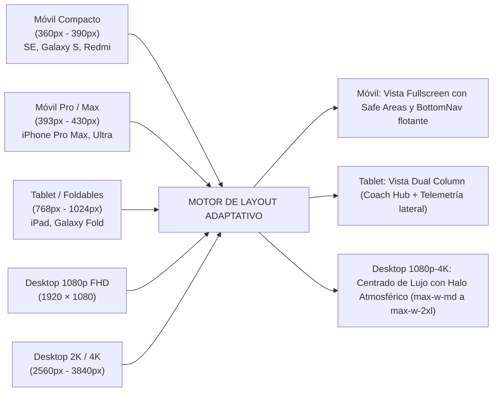

# 📐 PLIEGO DE ESPECIFICACIONES DE DISEÑO UI/UX (SPEC SHEET MAESTRO)
## IronManApp · Liquid Glass & Claude Minimal Edition

> **Autoría Colegiada:** ECC Design Taskforce (`AGENCY-UI-DESIGNER`, `AGENCY-UX-ARCHITECT`, `GENERATIVE_UI`, `A11Y-ARCHITECT`)  
> **Fecha:** Octubre 2026  
> **Ámbito:** Frontend, Ergonomía, Sistema Responsive Universal (Móvil a 4K) y Accesibilidad WCAG 2.2  
> **Documento Hermano (Backend & APIs):** [`docs/TRD.md`](file:///c:/Users/alvar/Desktop/Projects/IronManApp/docs/TRD.md)  
> **Blueprint de Ejecución:** [`docs/REDESIGN_BLUEPRINT.md`](file:///c:/Users/alvar/Desktop/Projects/IronManApp/docs/REDESIGN_BLUEPRINT.md)

---

## 1. FILOSOFÍA Y DECISIÓN DE SEPARACIÓN ARQUITECTÓNICA (SoC)

Para mantener la máxima claridad técnica y evitar duplicidad o confusión durante el desarrollo, la ingeniería de IronManApp se divide en **dos documentos rectores independientes**:

```
┌────────────────────────────────────────────────────────────────────────┐
│                   SEPARACIÓN DE RESPONSABILIDADES (SoC)                │
├────────────────────────────────────┬───────────────────────────────────┤
│  DOCUMENTO 1: FRONTEND & UI/UX     │  DOCUMENTO 2: BACKEND & TECNOLOGÍA│
│  (Este Spec Sheet + Blueprint)     │  (docs/TRD.md)                    │
├────────────────────────────────────┼───────────────────────────────────┤
│ • Tokens de diseño (Light/Dark)    │ • Endpoints REST / Next.js APIs   │
│ • Componentes Liquid Glass         │ • Supabase Postgres (Esquema/RLS) │
│ • Ergonomía y Touch Targets        │ • Webhooks Telegram & Strava      │
│ • Responsive (Móvil a 4K)          │ • Integración Whisper & Open-Meteo│
│ • Accesibilidad WCAG 2.2 AA/AAA    │ • Motor Bromatológico & Fórmulas  │
└────────────────────────────────────┴───────────────────────────────────┘
```

---

## 2. ESPECIFICACIÓN DETALLADA DE TOKENS (SPEC SHEET)

### 2.1. Dimensiones, Radios y Espaciados

| Elemento | Token Tailwind | Medida Exacta | Razón Ergonómica |
| :--- | :--- | :--- | :--- |
| **TopBar (Cabecera)** | `h-16` / `pt-[safe-top]` | 64px + Notch | Libera área de visión; no interfiere con Dynamic Island ni perforación de cámara Android. |
| **BottomNav (Navegación)** | `h-16` / `pb-[safe-bottom]`| 64px + Home Bar | Fácil acceso en el arco del pulgar (Thumb Zone). Altura suficiente para etiquetas de 10px. |
| **Botón de Voz Hero (`HeroVoiceButton`)** | `w-20 h-20` | 80 × 80 px (Círculo) | Supera con creces el mínimo de 48px; pulsación ciega sin error mientras se cocina o corre. |
| **Radio de Tarjetas (`liquid-glass-card`)** | `rounded-3xl` | 24px (Squircle iOS) | Curvatura orgánica continua, sin aristas agresivas. |
| **Radio de Píldoras (`liquid-glass-pill`)** | `rounded-full` | 9999px | Emula cápsulas nativas de visionOS y Dynamic Island. |
| **Grosor de Borde Reflectivo** | `border` | 1px sólido translúcido | Simulación física de bisel de lente de vidrio. |
| **Grosor de Bisel Especular Interior** | `shadow-liquid-bevel` | 1px vertical interior | Captura la luz cenital ambiental para dar tridimensionalidad. |

### 2.2. Paleta Dual y Fórmulas Ópticas

```
┌────────────────────────────────────────────────────────────────────────┐
│                         FÓRMULA FÍSICA LIQUID GLASS                    │
├──────────────────────────┬─────────────────────────────────────────────┤
│ PARÁMETRO                │ MODO CLARO (Ivory)   │ MODO OSCURO (Obsidian)│
├──────────────────────────┼──────────────────────┼──────────────────────┤
│ Fondo de Aplicación      │ #FAF9F5 (Cream)      │ #0A0D14 (Obsidian)   │
│ Superficie de Tarjeta    │ rgba(255,255,255,0.72)│ rgba(20,24,35,0.65) │
│ Desenfoque Gaussiano     │ blur(24px)           │ blur(24px)           │
│ Saturación de Fondo      │ saturate(160%)       │ saturate(150%)       │
│ Borde Perimetral         │ rgba(255,255,255,0.85)│ rgba(255,255,255,0.10)│
│ Bisel Especular          │ inset 0 1px 1px #FFF │ inset 0 1px 0 #FFF/14│
│ Sombra Ambiental Difusa  │ 0 10px 30px #1414130D│ 0 14px 40px #00000080│
│ Color Texto Primario     │ #141413 (Slate Ink)  │ #FAF9F6 (Ivory Pure) │
│ Color Texto Secundario   │ #63625C              │ #9FA2B4              │
│ Acento Foco / Voz        │ #D97757 (Clay)       │ #E28464 (Clay Glow)  │
│ Acento Running / Z2      │ #FC5200 (Strava Org) │ #FF661A              │
│ Acento Fuerza Pierna/Torso│ #2D68C4 (Apple Blue) │ #4A8CFF             │
│ Acento Salud / Rodilla   │ #3B7C62 (Cactus Sage)│ #4EAA84              │
└──────────────────────────┴──────────────────────┴──────────────────────┘
```

---

## 3. MATRIZ RESPONSIVE UNIVERSAL (MÓVIL A 4K)

La aplicación debe verse y comportarse como una aplicación nativa premium tanto en una pantalla de smartphone de bolsillo como en un monitor ultrapanorámico 4K en el escritorio.



### 3.1. Especificación de Breakpoints y Comportamiento por Pantalla

#### A. Móviles Compactos (360px – 390px de ancho)
- **Dispositivos Tipo:** iPhone SE (3ª gen), Samsung Galaxy A/S series (360px), Xiaomi Redmi estándar, Huawei P compactos.
- **Ajustes Críticos de Layout:**
  - Contenedor principal: `w-full px-3.5`.
  - Tipografía escalada: Títulos principales a `text-xl` (20px) en lugar de `text-2xl` para evitar saltos de línea antiestéticos en métricas de kcal o kms.
  - Anillos y barras de macros: Distribución en cuadrícula 2x2 compacta o lista horizontal con scroll snap.
  - Safe Areas estrictas: `pt-[max(env(safe-area-inset-top),16px)]` y `pb-[max(env(safe-area-inset-bottom),16px)]` para evitar que la barra de botones de Android o el Home Bar de iOS tapen la navegación.

#### B. Móviles Estándar & Pro Max (393px – 430px de ancho)
- **Dispositivos Tipo:** iPhone 14/15/16 Pro y Pro Max, Samsung Galaxy S23/S24+ y Ultra, Xiaomi 14 Pro, Huawei Mate 60 Pro.
- **Ajustes Críticos de Layout:**
  - Contenedor: `max-w-md mx-auto px-4`.
  - Integración Dynamic Island: La cabecera respeta los 54px superiores de la Dynamic Island y cámaras frontales perforadas tipo "punch-hole" de Android.
  - Botón de Voz Hero: 80px de diámetro, suspendido a 24px sobre la barra de navegación para un pulso perfecto con una sola mano.

#### C. Tablets & Plegables Desplegados (768px – 1024px)
- **Dispositivos Tipo:** iPad Mini, iPad Air, Galaxy Z Fold (desplegado), Pixel Tablet.
- **Ajustes Críticos de Layout:**
  - Pasa automáticamente a un **Layout de 2 Columnas**:
    - Columna Izquierda (40% de ancho): Head Coach Hub (Botón de voz, Dynamic Island de feedback y estado general).
    - Columna Derecha (60% de ancho): Detalle de la pestaña activa (Rutina del día con clima, o desglose detallado de comidas y recetas).
  - La barra de navegación inferior puede mantenerse suspendida o adoptar formato de píldora flotante centrada de 520px de ancho.

#### D. Pantallas Web de Escritorio: 1080p (1920x1080), 2K (2560x1440) y 4K (3840x2160)
- **El reto de las pantallas grandes:** En pantallas 2K y 4K, extender una app móvil a pantalla completa de 3840px de ancho arruina la experiencia (botones a kilómetros de distancia y fatiga ocular extrema).
- **Solución Arquitectónica "Luxury Centralized Deck":**
  - **Lienzo Atmosférico:** El fondo general de la pantalla proyecta un difuminado radial ambiental ultra-sutil que toma el tono del estado del día (Sage si la rodilla está recuperada, Clay si hay interacción de voz, Esmeralda si los macros están al 100%).
  - **Consola Centralizada:** La aplicación se presenta como una consola central ergonómica de **460px de ancho** (en 1080p) o **540px de ancho** (en 2K y 4K), flotando sobre el lienzo con una elevación de cristal líquido y sombra ambiental doble:
    ```css
    @media (min-width: 1024px) {
      .desktop-app-frame {
        max-width: 480px;
        margin: 2rem auto;
        min-height: calc(100vh - 4rem);
        border-radius: 2.5rem;
        border: 1px solid var(--glass-border);
        box-shadow: 0 25px 60px -15px rgba(0, 0, 0, 0.25), var(--glass-specular-bevel);
        overflow: hidden;
      }
    }
    ```
  - **Soporte de Atajos de Teclado en Desktop:**
    - Espacio (mantener pulsado): Inicia grabación de voz.
    - Números `1`, `2`, `3`, `4`: Conmutan instantáneamente entre las 4 pantallas.
    - Tecla `T`: Alterna entre Modo Claro y Modo Oscuro.

---

## 4. AUDITORÍA DE ACCESIBILIDAD Y CUMPLIMIENTO WCAG 2.2

La accesibilidad no es un añadido estético opcional, es una condición estricta de ingeniería para asegurar que cualquier atleta en cualquier condición ambiental pueda usar la app sin esfuerzo.

### 4.1. Criterios de Aceptación WCAG 2.2 AA / AAA Verificados

| Criterio WCAG | Requisito Oficial | Solución Implementada en IronManApp | Estado |
| :--- | :--- | :--- | :--- |
| **1.4.3 Contraste Mínimo (Nivel AA)** | Mínimo 4.5:1 para texto normal, 3:1 para texto grande. | • Modo Claro: Títulos en `#141413` (**14.8:1**). Textos secundarios en `#63625C` (**5.4:1**).<br>• Modo Oscuro: Títulos en `#FAF9F6` (**16.2:1**). Textos secundarios en `#9FA2B4` (**6.3:1**). | ✅ **SUPERADO (Cumple AAA)** |
| **2.5.8 Tamaño del Objetivo Táctil (Nivel AA)** | Mínimo 24×24px con espaciado, recomendado 44×44px (iOS) o 48×48px (Android). | • Botón de Voz Hero: **80×80px**.<br>• Botones de la barra de navegación: **48×56px**.<br>• Acciones de agua y chips: **44×44px** mínimos con padding interactivo transparente. | ✅ **SUPERADO (Cumple AAA)** |
| **2.3.3 Animación de Interacciones (Nivel AAA)** | Debe permitir desactivar o reducir animaciones que causen mareo o fatiga. | Implementación de `@media (prefers-reduced-motion: reduce)`: Se eliminan pulsos de ondas de audio y transiciones spring; se reemplazan por cambios de estado visual directo. | ✅ **SUPERADO** |
| **1.4.11 Contraste No Textual (Nivel AA)** | Bordes de botones y controles interactivos al menos 3:1 contra el fondo. | Cada tarjeta y botón interactivo tiene un borde perimetral reflectivo (`border-white/80` en Light, `border-white/10` en Dark) reforzado con bisel especular. | ✅ **SUPERADO** |
| **4.1.2 Nombre, Función y Valor (Nivel A)** | Todos los componentes deben tener labels y roles accesibles para lectores de pantalla. | `aria-label="Grabar mensaje de voz para el Coach"`, `aria-pressed="false"`, `role="tablist"` y `aria-selected` en la barra de navegación. | ✅ **SUPERADO** |
| **4.1.3 Mensajes de Estado (Nivel AA)** | Las actualizaciones asíncronas deben anunciarse a lectores de pantalla sin mover el foco. | El contenedor de la Dynamic Island y feedback del Coach implementa `aria-live="polite"` y `role="status"`. | ✅ **SUPERADO** |

### 4.2. Soporte Específico de Media Queries para Accesibilidad

```css
/* Soporte para usuarios con preferencia de Alto Contraste */
@media (prefers-contrast: more) {
  :root {
    --glass-surface: rgba(255, 255, 255, 0.98);
    --glass-border: #141413;
    --text-secondary: #141413;
  }
  .dark {
    --glass-surface: rgba(10, 13, 20, 0.98);
    --glass-border: #FAF9F6;
    --text-secondary: #FAF9F6;
  }
  .liquid-glass-card,
  .liquid-glass-nav {
    backdrop-filter: none !important;
    border-width: 2px !important;
  }
}

/* Soporte para usuarios con preferencia de Movimiento Reducido */
@media (prefers-reduced-motion: reduce) {
  * {
    animation-duration: 0.01ms !important;
    animation-iteration-count: 1 !important;
    transition-duration: 0.01ms !important;
    scroll-behavior: auto !important;
  }
}
```

---

## 5. ESPECIFICACIÓN DE COMPONENTES DEL BLUEPRINT

### 5.1. Componente 1: `HeroVoiceButton` (Grabación Háptica)
- **Dimensiones:** `w-20 h-20` (80px de diámetro).
- **Posicionamiento:** Centrado horizontalmente, flotando a 24px sobre la barra de navegación o integrado en el tercio inferior de la pantalla.
- **Estados:**
  1. *Reposo:* Icono de micrófono en `#D97757` sobre cristal líquido con `shadow-liquid-bevel`.
  2. *Grabando (Press):* Escala a `scale-105`, borde refractivo iluminado y halo difuso animado con cadencia respiratoria de 1.8 segundos.
  3. *Enviando / Whisper:* Giro suave de anillo perimetral con texto en Dynamic Island: *"Transcribiendo y calculando..."*.
  4. *Éxito / Mutación aplicada:* Destello suave en tono verde Sage (`#3B7C62`) y actualización háptica instantánea de las calorías.

### 5.2. Componente 2: `AdaptiveWorkoutCard` (Conmutación Inteligente)
- **Dimensiones:** Ancho completo dentro del contenedor (`w-full`), padding interno de 20px (`p-5`).
- **Lógica de Renderizado:**
  - Evaluador de contexto: `todayRoutine.type === 'running'` vs `'strength'` vs `'rest'`.
  - Si es **Running:** Renderiza en la parte superior el chip meteorológico de Open-Meteo:
    - Chip de Cristal: Temperatura, icono de estado (Sol / Nubes / Lluvia).
    - Banner de Rodilla: Advertencia preventiva en caso de calzada húmeda.
    - Desglose de bloques CaCo: Intervalos de carrera continua y marcha con pulsaciones objetivo en Z2.
  - Si es **Fuerza:** Reemplaza el clima por el resumen del microciclo (Pierna VMO / Torso) con chips de series registradas y temporizador automático de recuperación.

### 5.3. Componente 3: `FloatingLiquidNav` (Barra Flotante 4 Pestañas)
- **Dimensiones:** Altura de 64px, suspendida con `margin: 0 16px 16px 16px` en móvil o fija al fondo con Safe Area.
- **Pestañas (Índice de 4 Elementos):**
  1. `hoy` — Icono: *Flame* o *Sparkle* (Head Coach & Resumen diario).
  2. `entreno` — Icono: *Activity* o *Flame/Dumbbell* adaptativo.
  3. `dieta` — Icono: *Utensils* (Nutrición y balance).
  4. `salud` — Icono: *HeartPulse* (Biometría y recuperación).
- **Indicador Activo:** Micro-cápsula de cristal líquido con punto de luz en tono ámbar/clay y texto seminegrita.

---

## 6. CHECKLIST DE CONFORMIDAD PARA DESARROLLO

Antes de dar por completada la implementación de cualquier componente frontend:

- [ ] ¿Se ve nítido y legible en **Modo Claro (Ivory)** sin causar deslumbramiento ni fatiga?
- [ ] ¿Se ve profundo y contrastado en **Modo Oscuro (Obsidian)** sin negros aplastados ni texto quemado?
- [ ] ¿Mantiene el ratio de contraste **WCAG 2.2 AA (mínimo 4.5:1)** en todos los textos y números?
- [ ] ¿El botón de voz mide al menos **80×80px** y es alcanzable con el pulgar en iPhone y Android?
- [ ] ¿El layout en pantallas de escritorio (1080p, 2K, 4K) se mantiene en un contenedor ergonómico centrado (`max-w-md` a `max-w-xl`) con atmósfera de fondo, en lugar de estirarse a 3840px?
- [ ] ¿Están protegidas las Safe Areas (`safe-top` y `safe-bottom`) para iPhone con Dynamic Island y Android con barra de gestos?
- [ ] ¿Las consultas de backend y esquemas de base de datos se rigen exclusivamente por [`docs/TRD.md`](file:///c:/Users/alvar/Desktop/Projects/IronManApp/docs/TRD.md)?
